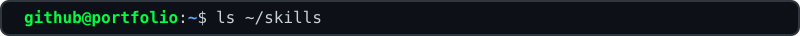
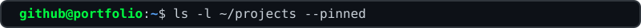
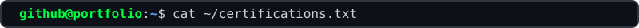
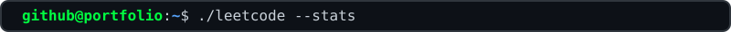
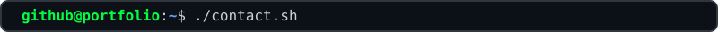

<!--
  QUICK MAP (top to bottom): header > skills > projects > certs > leetcode > contact > end cursor
  LAYOUT RULES: every block is 800px wide, every table uses cellpadding 10, one   between sections.
  COLORS: green 00ff41 = prompt/accent, blue 58a6ff = path, 161b22 = badge background (matches terminal).
  PLACEHOLDERS (Ctrl+H, replace all): GH_USERNAME, REPO_NAME, PROJECT_NAME, DESCRIPTION, TECH,
    CERTIFICATION_NAME, ISSUING_ORGANIZATION, YEAR, LC_USERNAME, LINKEDIN_USERNAME, YOUR_PORTFOLIO_URL
  WHY SVG PROMPTS: GitHub strips colors from text, so only images can be green. Everything else is real text.
  NOTE: column widths below add up to 800 so tables line up with the SVG prompts. Keep that total.
-->

<!-- HEADER: animated terminal window -->

 

<!-- SKILLS: label column 130 + badges column 670 = 800. To add a skill, copy one img line. -->

<table width="800" cellpadding="10" cellspacing="0">
<tr>
<td width="130" valign="middle"><code>languages</code></td>
<td width="670" valign="middle">

</td>
</tr>
<tr>
<td valign="middle"><code>frontend</code></td>
<td valign="middle">

</td>
</tr>
<tr>
<td valign="middle"><code>backend</code></td>
<td valign="middle">

</td>
</tr>
<tr>
<td valign="middle"><code>testing</code></td>
<td valign="middle">

</td>
</tr>
<tr>
<td valign="middle"><code>devOps & deployment</code></td>
<td valign="middle">

</td>
</tr>
</table>

 

<!-- PROJECTS: columns # 60 + project 200 + description 340 + tech 200 = 800. Copy a tr block to add a row. -->

<!-- 

<table width="800" cellpadding="10" cellspacing="0">
<tr>
<th width="60" align="center"><code>#</code></th>
<th width="200" align="left"><code>project</code></th>
<th width="340" align="left"><code>description</code></th>
<th width="200" align="left"><code>stack</code></th>
</tr>
<tr>
<td align="center" valign="middle">1</td>
<td valign="middle"><b><a href="https://github.com/GH_USERNAME/REPO_NAME">PROJECT_NAME</a></b></td>
<td valign="middle">DESCRIPTION</td>
<td valign="middle"><code>TECH</code> <code>TECH</code></td>
</tr>
<tr>
<td align="center" valign="middle">2</td>
<td valign="middle"><b><a href="https://github.com/GH_USERNAME/REPO_NAME">PROJECT_NAME</a></b></td>
<td valign="middle">DESCRIPTION</td>
<td valign="middle"><code>TECH</code> <code>TECH</code></td>
</tr>
<tr>
<td align="center" valign="middle">3</td>
<td valign="middle"><b><a href="https://github.com/GH_USERNAME/REPO_NAME">PROJECT_NAME</a></b></td>
<td valign="middle">DESCRIPTION</td>
<td valign="middle"><code>TECH</code> <code>TECH</code></td>
</tr>
</table>
 -->
 

<!-- CERTS: columns # 60 + certification 340 + issuer 250 + year 150 = 800. Only list earned ones. -->

<table width="800" cellpadding="10" cellspacing="0">
<tr>
<th width="60" align="center"><code>#</code></th>
<th width="340" align="left"><code>certification</code></th>
<th width="250" align="left"><code>issuer</code></th>
<th width="150" align="left"><code>year</code></th>
</tr>
<tr>
<td align="center" valign="middle">1</td>
<td valign="middle">AZ</td>
<td valign="middle">MS</td>
<td valign="middle">202</td>
</tr>
<tr>
<td align="center" valign="middle">2</td>
<td valign="middle">ASP</td>
<td valign="middle">MS</td>
<td valign="middle">202</td>
</tr>
<tr>
<td align="center" valign="middle">3</td>
<td valign="middle">Foundational C# with Microsoft</td>
<td valign="middle">freeCodeCamp</td>
<td valign="middle">2026</td>
</tr>
</table>

 

<!-- LEETCODE: LIVE STATS -->

<table width="800" cellpadding="10" cellspacing="0">
  <tr>
    <td valign="middle" width="130"><code>leetcode</code></td>
    <td valign="middle" width="670">
      <a href="https://leetcode.com/u/Muqeet_Ryan/">
        leetcode.com/u/Muqeet_Ryan ↗
      </a>
    </td>
  </tr>
  <tr>
    <td colspan="2" align="center">
      
    </td>
  </tr>
</table>

 

<!-- CONTACT: three equal cells (267 + 266 + 267 = 800), badges centered so the row is symmetrical. Delete a cell to remove a link. -->

<table width="800" cellpadding="10" cellspacing="0">
<tr>
<td width="267" align="center" valign="middle"></td>
<td width="266" align="center" valign="middle"></td>
<td width="267" align="center" valign="middle"></td>
</tr>
</table>

 

<!-- END: final prompt with blinking cursor -->

